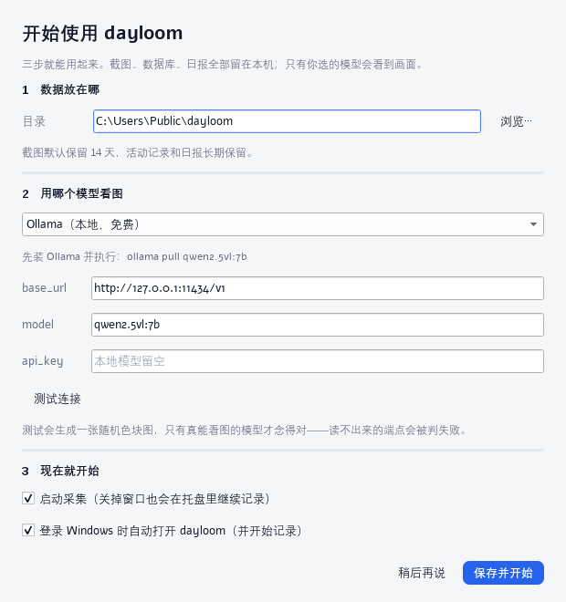
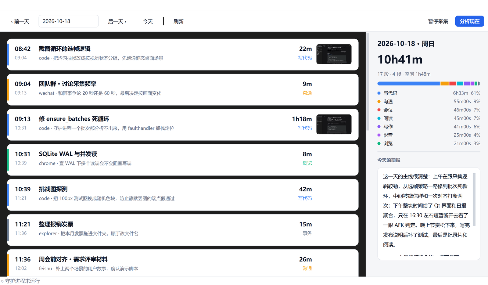

# dayloom

**简体中文 | [English](README.en.md)**

A **local-first screen activity diary** for Windows. It samples the foreground
window on a timer, understands the picture with a vision model, and turns your
day into a timeline of "what was I doing, and for how long".

No accounts, all data stays on your machine, Windows as a first-class citizen.
MIT.

**[Download the packaged v0.1.0](../../releases/download/v0.1.0/dayloom-v0.1.0-windows-x64.zip)** — Windows x64, portable, unzip and run `dayloom-gui.exe`; see [Releases](../../releases/latest) for other versions.

> **How it differs from similar tools.** [ActivityWatch](https://activitywatch.net)
> records *which windows you had open* — app name + window title + AFK time —
> but never looks at the picture. [Dayflow](https://github.com/JerryZLiu/Dayflow)
> does something like dayloom on macOS with a local small model. dayloom's
> choice: only connect models that can **actually see images**, and force them,
> in the prompt, to answer "what was being done" instead of parroting the app
> name. So the timeline says *"tuning the screenshot dedup threshold, running
> unit tests over and over"*, not *"VS Code 3h12m"*.

---

## How it works

```
  sample foreground every 2s               store a frame only when it changed
┌───────────────────────┐        ┌───────────────────────────────────┐
│ foreground + DPI      │  ───▶  │ dHash dedup + heartbeat +         │
│ idle/lock/blacklist   │        │ stillness anchors                 │
│ checks                │        │ WebP on disk → SQLite             │
└───────────────────────┘        └───────────────────────────────────┘
                                            │
        one batch per 15 min, analyzed 2 min after its window closes
                                            ▼
┌─────────────────────────────────────────────────────────────────┐
│ pick frames by "visual state" → the model also gets the full    │
│ timeline of every frame (time / monitor / foreground app), plus │
│ sampled frames with a magnified taskbar badge strip             │
│ → model returns {from_frame,to_frame,category,summary}          │
│ → map back to timestamps, fill gaps, de-overlap                 │
│   → activities (immutable raw segments)                         │
└─────────────────────────────────────────────────────────────────┘
                                            │
                                            ▼
              sessions (derived, recomputable) → daily report (numbers from SQL)
```

Two deliberate design decisions:

1. **The model says "what", never "how long".** It returns frame-index ranges;
   timestamps and durations are all computed locally. "How long did each thing
   take" cannot be hallucinated.
2. **Raw segments are immutable.** `activities` stores the model's raw output
   only; `sessions` is a derived layer. After switching models or editing
   prompts, history can be recomputed without losing the original.

---

## Quick start

Requires Windows 10/11 and Python 3.11+.

```powershell
git clone <repo> && cd dayloom
python -m venv .venv
.\.venv\Scripts\python -m pip install -e ".[dev]"

.\.venv\Scripts\dayloom doctor        # self-check first: DPI / capture / idle / dirs / disk
.\.venv\Scripts\dayloom capture-once  # grab one frame right away, confirm capture works
```

**Get the whole pipeline working with no model at all** (built-in fake model,
no network, no cost):

```powershell
# terminal 1
dayloom mock-vlm --port 8677

# terminal 2: point [llm] in config.toml at http://127.0.0.1:8677/v1
dayloom start -v
```

Once a batch has accumulated:

```powershell
dayloom analyze     # run pending batches manually
dayloom report      # today's timeline
```

Hooking up a real model is three lines in `config.toml`, then:

```powershell
dayloom probe-llm   # verify it can really see images, via a challenge image
```

---

## Desktop app

### Install as an app (for people who don't use terminals)

```powershell
# build once on a dev machine
powershell -ExecutionPolicy Bypass -File packaging\build.ps1

# install for the current user (no admin required)
powershell -ExecutionPolicy Bypass -File packaging\install.ps1 -Desktop
```

After installing:

- **dayloom appears in the Start menu** (plus a desktop icon with `-Desktop`), double-click to open;
- an uninstall entry shows up under "Settings → Apps".

**Uninstalling keeps your data by default.** The program directory,
shortcuts, registry keys and autostart entries are removed; `~/dayloom`
(screenshots, database, reports) is left untouched, and a dialog tells you
where the data is and how big it is. Only pass `-RemoveData` if you really
want the data gone too.

**The first launch asks three questions**, after which it just works — no
terminal needed:



1. Where to put the data (default `~/dayloom`)
2. Which model looks at the images (Ollama / llama.cpp / LM Studio / custom
   cloud endpoint, with "test connection" — done via a challenge image, not a ping)
3. Start recording now? Launch at login?

You can also skip the model for now (capture only, no analysis) and add it
later under "Tools → Settings → Vision model".

### Run from source

```powershell
pip install "dayloom[qt]"   # PySide6 (LGPL, MIT-compatible; do not use GPL PyQt)
dayloom gui
```

Screenshot (**synthetic demo day**, not real capture):



- **Timeline on the left**: start–end times, what was done, category colors,
  duration; click any segment to see the frame captured at that moment.
- **Briefing on the right**: total tracked time, category breakdown with color
  bar, and the model's written recap of the day.
- **Top bar**: go to previous/next day or pick a date, pause/resume capture,
  analyze pending batches now.
- Closing the window **hides it to the tray** (the app keeps watching data);
  truly quit via the tray menu's "Quit dayloom".
- Tray menu: tracked time today, open main window, pause capture, analyze now,
  open data folder, quit.
- The tray's "self-check" and "vision model → test connection" run the same
  checks as the CLI, on background threads, so they never block the UI.

The GUI is a **read-only** client of the database (WAL allows many readers);
writes are still done only by the daemon and the CLI — a UI crash can't lose
data. So the recommended setup is:

```powershell
# terminal 1: persistent capture (or set up autostart)
dayloom start

# terminal 2 (or a shortcut): the UI
dayloom gui
```

### Launch at login

```powershell
dayloom autostart status     # is it on, and which mechanism
dayloom autostart enable     # on: opens the UI at login (the UI starts capture itself)
dayloom autostart disable    # off
```

Also in the GUI: **Tools → Launch at login** (tick to enable).

By default it **opens the UI**, not just a background daemon: at login you see
the window and tray icon directly, and the UI starts capture. If this machine
is unattended (say, an always-on desktop) and you want background-only
capture:

```powershell
dayloom autostart enable --daemon
```

By default it avoids Task Scheduler, because creating an `ONLOGON` task
requires admin rights — a normally-launched process gets denied. Instead it
drops a shortcut into your **Startup folder**: no elevation, no console flash,
right-click to remove.

If you do run as administrator and prefer a scheduled task (supports delays,
survives Explorer restarts):

```powershell
dayloom autostart enable --scheduled
```

(if `--scheduled` fails it falls back to the Startup folder and tells you why.)

### Settings

GUI: **Tools → Settings**, three pages (capture / storage & privacy / vision
model).

- Saving **doesn't require restarting the daemon**: every 2 s it checks the
  mtime of `config.toml` and hot-reloads + rebuilds the capture loop on change.
- Saving rewrites the whole file (comments are lost); the old file is backed
  up as `config.toml.bak`. To keep comments, edit the file directly — it gets
  hot-reloaded all the same.
- Changing `data_dir` requires a daemon restart — the database path can't be
  hot-swapped.
- "Test connection" is the same challenge-image probe as the CLI, with the
  same result as `dayloom probe-llm`.

### One-line daily summary

On the first launch after the day boundary (or live when the clock crosses
it), the tray pops once:

> **Yesterday you tracked 6h12m**
> coding 61% · communication 12% · meetings 9%
> click here to see 2026-10-17's timeline

Clicking jumps straight to that day. Pops at most once per day (recorded in
`~/dayloom/.gui-state.json`, not the database).

### Daily reports

Generated automatically just after each day boundary (15 min past midnight in
logical-day terms) and stored in the `daily_reports` table. **If the machine
was asleep at that moment, the daemon backfills on its next start** (looks
back 14 days, and only for days that had real activity but no report).

Three entry points:

| Where | How |
|---|---|
| GUI | **Tools → Daily reports…** pick a date on the left, read narrative / breakdown / highlights / suggestions on the right, jump to that day's detail with one click |
| CLI | `dayloom reports` lists all; `dayloom reports --show 2026-10-22` prints one |
| Day view | the right sidebar already holds that day's briefing; or `dayloom report --date 2026-10-22` to generate it on the spot |

### Weekly review

```powershell
dayloom week                     # this week (Mon–Sun)
dayloom week --date 2026-10-14   # the week containing a given day
dayloom week --json
```

GUI: **Tools → This week…**

```
2026-10-12 – 2026-10-18 · tracked 40h41m
──────────────────────────────────────────────────────────────
Mon    4h00m  █████████                 learning
Tue    5h30m  ████████████              meetings
Wed    2h00m  ████                      admin
...
──────────────────────────────────────────────────────────────
coding 20h03m 49% · meetings 6h16m 15% · writing 5h41m 14% · learning 4h00m 10%
```

Numbers still come from SQL (aggregated from the seven daily reports); the
model only writes the narrative. Stored in `weekly_reports`, reading it never
re-runs the model.

### Icon and Start menu

```powershell
dayloom shortcut install              # Start menu
dayloom shortcut install --desktop    # plus a desktop icon
dayloom shortcut remove
```

GUI: **Tools → Shortcuts**.

The icon is a [script-generated](scripts/make_icon.py) multi-size `.ico`
(16/24/32/48/64/128/256); tray, window, Start menu and the packaged exe all
use the same one. To change the design, tweak the geometry in
`scripts/make_icon.py`, run it, repackage.

### Packaging an exe

```powershell
powershell -ExecutionPolicy Bypass -File packaging\build.ps1
```

Output lands in `dist\dayloom\`:

| File | Purpose |
|---|---|
| **`dayloom-gui.exe`** | **Windowed build: the desktop app. Double-click this for the UI** (Start-menu shortcut points here) |
| `dayloom.exe` | Console build: all CLI commands + the background daemon |

If you double-click `dayloom.exe` it prints one page of help and waits for
Enter — it doesn't flash and vanish.

The two exes are separate on purpose, not laziness: the windowed subsystem
has no stdout, so a CLI inside it would print nothing; and double-clicking a
console program flashes a black window. Both share one dependency directory.

In the packaged build, "start capture" points at `dayloom.exe` (not
`sys.executable`); autostart points at `dayloom-gui.exe`, and the UI brings
the daemon up itself — so at login you see a window, not a black box.

---

## Configuration

Every field is documented in [`config.example.toml`](config.example.toml);
the file lives at `~/dayloom/config.toml`. The ones worth touching first:

| Setting | Default | Notes |
|---|---|---|
| `capture.mode` | `full_monitor` | `full_monitor` captures the **whole monitor** the foreground window is on; `active_window` captures just the window rectangle (smaller image); `all_monitors` stitches every monitor into one image (you see both screens, but text is smaller and tokens higher) |
| `capture.probe_interval` | 2.0 | how often to check the foreground (cheap); a frame is stored only on change (expensive) |
| `capture.heartbeat` | 20.0 | minimum interval between frames while the picture keeps changing |
| `capture.max_still_minutes` | 10 | when the picture is perfectly still, at most one evidence frame per this many minutes |
| `capture.blacklist_titles` | password managers etc. | windows matching these regexes are **never captured** — no file is even created |
| `general.day_boundary_hour` | 4 | when the logical day starts. Night owls: set to 4, so 2 a.m. still counts as "yesterday" |
| `storage.keep_frames_days` | 14 | days to keep screenshots; activity records and reports are kept indefinitely |
| `llm.max_frames` | 12 | max frames per request. Small-context local models: drop to 4–6 |
| `llm.focus_strip` | true | add one magnified "taskbar badge strip" per batch (better multi-monitor judgement, tiny cost); turn off for extremely tight local contexts |

### Multiple monitors

| `capture.mode` | What is captured | Best for |
|---|---|---|
| `full_monitor` (default) | the **one monitor** the foreground window is on (whole screen, incl. other windows on it) | single-monitor-dominant setups; full context without crediting the other screen |
| `active_window` | just the foreground window's rectangle | strictest privacy; but small windows make small images |
| `all_monitors` | all monitors stitched into one | true dual-screen use, "what's playing over there"; costs bigger images and smaller text |

**How it knows "where you currently are"**: every frame records the foreground
window at capture time (app + title + monitor), and at analysis time *all* of
this metadata goes into the prompt — not just the sampled frames. So a
15-minute stretch of bouncing between two screens shows the model the complete
switching timeline, not a snapshot of the last few frames.

Each batch also carries a "taskbar strip": the taskbar regions of the sampled
frames are cropped, magnified and stitched in frame order. On the taskbar, the
wider item with a highlight background below the icon (the badge) is the app
in front at that moment — with multiple monitors or many windows on one
screen, the model trusts "badge + that frame's foreground app", so a video
playing on the other screen won't get this time labelled as media.

If no taskbar can be found (fullscreen apps, auto-hide, custom docks) it
degrades gracefully to foreground-window metadata only; set
`llm.focus_strip = false` to disable the strip. This evidence only applies to
frames captured after upgrading — historical frames have no taskbar position
recorded and are skipped automatically; recomputing old batches still gets
correct segments from the full timeline.

To diff segment changes on historical batches (after switching models or
editing prompts):

```powershell
dayloom analyze --date 2026-10-25 --redo
```

How time is counted: **only one primary activity exists per instant** (the
window you're interacting with). A livestream or music playing on the other
screen is background and isn't timed separately — that's the definition of
"what you were doing". To count it too, switch to `all_monitors` and describe
things more coarsely at the prompt level (the default already does).

### Why media entries are deliberately coarse

Watching video produces hundreds of near-identical screenshots; having the
model describe them frame-by-frame yields only danmaku and scene details,
useless for a time log. So:

- the prompt states explicitly: `media` entries are one sentence, "watching
  what on which platform"; transcribing comments/subtitles is forbidden
- a **deterministic rewrite** runs before storage: for `category == media`,
  title and summary come straight from the window title, e.g. `在B站看直播：
  英雄联盟`, independent of model output
- durations no longer get stretched across batch boundaries: if a batch
  contains idle/lock gaps, a segment only extends to the gap's edge

---

## Hooking up a model

Only models that can **see images** are supported. Everything goes through
the OpenAI-compatible protocol (`base_url` + `api_key` + `model`), images as
base64 data-URLs in `image_url`.

Three verified setups:

```toml
# cloud (OpenAI-compatible gateway / any vision model)
[llm]
base_url = "https://your-endpoint/v1"
api_key  = "..."
model    = "your-vision-model"

# Ollama
[llm]
base_url = "http://127.0.0.1:11434/v1"
model    = "qwen2.5vl:7b"

# llama.cpp (llama-server, must pass --mmproj)
[llm]
base_url = "http://127.0.0.1:8080/v1"
model    = "qwen2.5-vl-7b"
```

**Validation on save.** `dayloom probe-llm` sends a locally generated
challenge image (five random color blocks) and asks the model to read the
color sequence back:

- A passing model actually saw the image.
- A failing model gets `"this model does not support image input"` and the
  config is rejected.

This isn't ceremony. The most dangerous kind of endpoint isn't one that
errors loudly — it's one that **silently drops the images** and returns a
perfectly plausible description anyway. Text-only models, some proxy
gateways, and llama.cpp without `mmproj` all do this. A flat solid-color test
image fools them; five random blocks don't (1/1024 chance of guessing).

The same probe also records: whether the endpoint supports `response_format`
(if not, prompt-level constraints are used as fallback), and whether images
are actually counted into `usage`.

### Tiered models: the expensive tier only when needed

Put a cheap or local model in the primary slot, escalation tiers under
`[[llm.tiers]]`. Each batch runs on the primary first and **escalates only if
quality is insufficient**:

```toml
[llm]
base_url  = "http://127.0.0.1:11434/v1"
model     = "qwen2.5vl:7b"
max_frames = 6

[llm.quality]
min_confidence    = 0.45   # escalate when average confidence drops below this
max_unknown_ratio = 0.25   # share of time labelled "unknown"
max_shallow_ratio = 0.5    # share of segments whose summary is just an app name/title

[[llm.tiers]]
name       = "cloud"
base_url   = "https://your-endpoint/v1"
api_key    = "..."
model      = "qwen3-vl-plus"
max_frames = 12
```

All three quality signals come from results already in hand — **no extra
requests** — so deciding whether to escalate is free; escalating is the only
thing that costs:

- Primary passes → use it; the day costs only the local model's electricity.
- Primary quality is poor (low confidence / long unknown stretches / shallow
  summaries) → rerun the batch on the escalation tier, overwriting the
  original segments (`activities` is idempotent on `(batch_id, seq)`).
- Primary fails outright (unreachable, or twice in a row invalid JSON) →
  fall to the next tier as well.

`batches.model` records which tier actually ran, and `dayloom cost` groups by
model:

```
date          model                batches   tokens in   tokens out
2026-10-18    qwen2.5vl:7b          31        18,204        2,010
2026-10-18    qwen3-vl-plus          4        21,880        3,410
```

`dayloom probe-llm` validates **each tier**, listing any tier that can't read
images.

### Local models (free, offline)

The official route is Ollama, but in practice pulling models from
`registry.ollama.ai` can be brutally slow in some regions (measured 0.01 MB/s
once — 3 GB ≈ 90 hours). A fast pairing in such regions is **llama.cpp + GGUF
from ModelScope**:

| Component | Source | Size | Measured speed |
|---|---|---|---|
| llama.cpp CPU build | GitHub release, via a mirror proxy | 19 MB | 0.5 MB/s |
| Qwen2.5-VL-3B Q4_K_M | `unsloth/Qwen2.5-VL-3B-Instruct-GGUF` on modelscope.cn | 1.8 GB | **22 MB/s** |
| mmproj-F16 (vision projector) | same | 1.25 GB | **22 MB/s** |

Drop them into `~/dayloom/models/`, then:

```powershell
powershell -File scripts\start-local-model.ps1      # serve (127.0.0.1:8080)
dayloom use-local --model qwen2.5vl-3b              # switch primary to local; old cloud model becomes the escalation tier
dayloom probe-llm                                   # must pass: unreadable blocks = vision not wired up
```

Real-world CPU speed: **3B Q4 ≈ 2 minutes per batch (4 frames)**. If that's
too hot, raise `analysis.batch_minutes` — fewer batches, each longer, fewer
total requests.

`use-local` doesn't discard your cloud config — it moves it into
`[[llm.tiers]]`: escalation happens only when local quality is poor. And a
**broken tier never blocks the primary** — if the cloud account runs out of
credit, local keeps working.

---

## Cost

Don't trust estimates — read the ledger:

```powershell
dayloom cost --days 7
```

It sums the actually-measured `tokens_in` / `tokens_out` per batch from the
database. Multiply by your tier's unit price for real money.

Order of magnitude (1024px long edge, roughly 800–1300 input tokens/frame):

| Setup | images/day | input tokens/day |
|---|---|---|
| 15-min batches × 4 frames | ~384 | ~0.4M |
| 15-min batches × 8 frames | ~768 | ~0.8M |
| 15-min batches × 12 frames | ~1152 | ~1.2M |

Change-driven capture + dHash dedup usually keeps real frame counts well under
the theoretical ceiling (a 20:15 batch may contain a single frame). The local
model column is always zero.

### Daily image budget (hard cap)

Cost is almost all images: prompt text and summaries together are under a
tenth. So rate limiting counts **images**, not money:

```toml
[analysis]
max_images_per_day = 480    # 0 = unlimited; when exhausted, analysis pauses, batches wait for tomorrow
```

- The daemon stops analyzing once the cap is hit, logs a reminder every half
  hour, and `dayloom status` shows `image budget today 372/480`
- `dayloom analyze` is blocked too, unless you pass `--ignore-budget`
- GUI: "Tools → Settings → Daily image budget" (0 = unlimited)

At 6 frames/batch and roughly 716 tokens/frame, 480 images ≈ 340k input
tokens/day. Multiply by your tier's price to see how long that lasts; the
"images" column in `dayloom cost` is the actual consumption.

**Batches queue, never drop** — analysis continues once tomorrow's budget
resets.

---

## Privacy

- **Foreground window only** (default). What's on the second monitor or in
  background windows never enters an image.
- **Blacklist applies at capture time**: windows matching a title regex or
  process name are not captured, not written to disk, not sent. The check
  happens before the screen grab.
- **Data never leaves your machine** unless you configure a cloud model
  yourself — and then what's sent is the screenshot itself. You should know
  that.
- Screenshots auto-delete after 14 days by default; activity records and
  reports are kept long-term and contain no images.
- `mock-vlm` listens on `127.0.0.1` only, no network.

---

## Commands

| Command | What it does |
|---|---|
| `dayloom start` | persistent: capture + analysis + reports + cleanup |
| `dayloom status [--json]` | processes, latest frame, batch state, vision probe results |
| `dayloom report [--date] [--json] [--no-llm]` | a day's timeline and report |
| `dayloom analyze [--date] [--limit] [--force] [--ignore-budget]` | analyze pending batches now (`--force` also reruns failed batches) |
| `dayloom reports [--days] [--show YYYY-MM-DD]` | list / print generated daily reports |
| `dayloom balance` | check model account balance (DeepSeek supported) |
| `dayloom gui [--day]` | open the desktop app (needs `dayloom[qt]`) |
| `dayloom week [--date] [--json]` | this week's summary (Mon–Sun) |
| `dayloom use-local [--model] [--url]` | switch primary to a local model; the old model becomes an escalation tier |
| `dayloom shortcut [install\|remove\|status]` | Start menu / desktop shortcuts |
| `dayloom autostart [enable\|disable\|status]` | open the UI at login (`--daemon` for background-only capture) |
| `dayloom pause` / `resume` | pause / resume capture (no daemon restart) |
| `dayloom capture-once` | grab one frame, verify the capture pipeline |
| `dayloom doctor [--llm]` | self-check: DPI, monitors, black-frame capture, idle/lock, dirs, database, disk |
| `dayloom probe-llm` | challenge-image check that the model can read images |
| `dayloom mock-vlm` | start the built-in fake model (no key needed) |
| `dayloom cost [--days]` | measured token ledger + today's image budget usage |
| `dayloom config [--example]` | print effective / example config |

---

## Where the data lives

```
~/dayloom/
├── config.toml        # your config (contains keys — don't commit it)
├── dayloom.db         # SQLite (WAL): frames / batches / activities / sessions / daily_reports / gaps
├── frames/YYYY-MM-DD/ # WebP screenshots, deleted after 14 days
└── logs/dayloom.log
```

---

## How stability is ensured

Running for days without dropping the ball rests on a few unglamorous but
critical mechanisms:

- **Daemon heartbeat**: `.heartbeat` is written every 20 s. A pid alone isn't
  enough — a crashed process leaves the pid file behind, and the pid may be
  reused by another program, so the UI would believe "recording" while
  nothing is. A heartbeat older than 180 s means dead.
- **UI watchdog**: checks every minute; if capture should be running but
  isn't, it starts it (also at login), reporting failures in the sidebar and
  status bar.
- **Quota/auth problems don't consume retries**: 401/402/403/404 need a human
  (top up, fix the key), so batches **return to the queue** instead of
  counting as failures — after recharging it just continues, nothing stuck in
  `failed` needing a manual reset.
- **Daily report backfill**: a rollup missed because the machine was asleep
  isn't lost forever; the daemon backfills within a 14-day lookback on its
  next start.
- **Stuck-batch recovery**: if the process dies mid-analysis, the batch
  automatically returns to the queue after 20 minutes.

---

## Current limitations (v0.1)

- **Windows only.** The capture layer is ctypes + mss with no cross-platform
  abstraction.
- Autostart defaults to a Startup-folder shortcut; a scheduled task
  (`--scheduled`) needs admin rights.
- Tiered models escalate whole batches; a batch can't be split across two
  models.
- The GUI allows one window at a time (file lock); a second one is told so.
- **Single writer**: the daemon and the CLI write the same database,
  serialized via WAL + short transactions. Don't run `start` twice.
- Activity categories are a fixed vocabulary; not user-definable.
- No web version; the desktop app and the CLI are the only two entry points.

---

## Development

```powershell
.\.venv\Scripts\python -m pytest -q
.\.venv\Scripts\python -m ruff check .
```

Tests never touch a real screen or a real model: HTTP goes through
`httpx.MockTransport`, and end-to-end runs use the built-in `mock-vlm` (which
genuinely reads the challenge image, so a broken pipeline turns tests red).

---

*简体中文 | [English](README.en.md)* — this is the English edition; the
Chinese one is the original and slightly more current.
