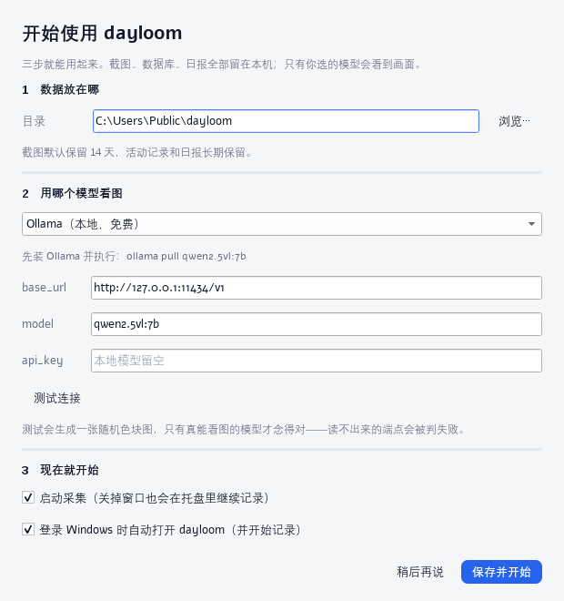
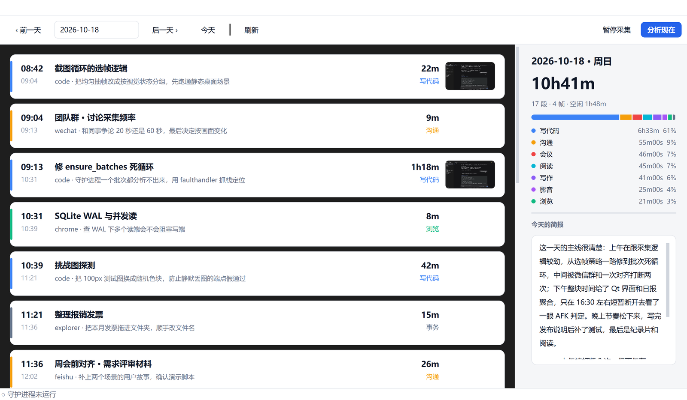

# dayloom

**本地优先的屏幕活动日记。** 定时截屏 → 视觉模型理解画面 → 一条「几点到几点在干嘛、每件事花了多久」的时间线。

零账号、数据全在本机、Windows 一等公民。MIT。

**[下载打包版 v0.1.0](../../releases/download/v0.1.0/dayloom-v0.1.0-windows-x64.zip)** —— Windows x64 免安装，解压运行 `dayloom-gui.exe`；其他版本见 [Releases](../../releases/latest)。

> **跟同类产品的区别。** [ActivityWatch](https://activitywatch.net) 记的是「你开了什么窗口」——应用名 + 窗口标题 + AFK 时长，不解画面内容。[Dayflow](https://github.com/JerryZLiu/Dayflow) 在 Mac 上用本地小模型做类似 dayloom 的事。dayloom 的选择是：只接**能看图的模型**，并且在提示词里强制它回答「在做什么事」，而不是复述应用名。所以时间线上写的是"改截图去重阈值，反复跑单测"，而不是"VS Code 3h12m"。

---

## 它怎么工作

```
 每 2 秒看一眼前台窗口              画面/应用变了才落帧
┌──────────────────────┐        ┌──────────────────────────┐
│ 前台窗口 + DPI 感知   │  ───▶  │ dHash 去重 + 心跳 + 静止锚点 │
│ 空闲/锁屏/黑名单判定   │        │ WebP 落盘 → SQLite         │
└──────────────────────┘        └──────────────────────────┘
                                            │
              每 15 分钟一个批次，窗口关闭后 2 分钟才分析        │
                                            ▼
┌──────────────────────────────────────────────────────────┐
│ 按「视觉状态」选帧 → 全部帧的时间线（时间/屏/前台）都给模型    │
│ → 抽样帧配截图 + 一张放大的任务栏徽标条（当前在哪个界面）      │
│ → 视觉模型返回 {from_frame,to_frame,category,summary}      │
│ → 本地映射回时间戳、补洞、去重叠 → activities（不可变原始段）  │
└──────────────────────────────────────────────────────────┘
                                            │
                                            ▼
                          sessions（派生，可重算）→ 日报（数字来自 SQL）
```

两条刻意的设计决定：

1. **模型只说"是什么"，不说"多久"。** 模型返回帧号区间，时间戳和时长全部由本地代码算。这样"每件事花了多久"不可能被编出来。
2. **原始段不可变。** `activities` 只存模型原始输出；`sessions` 是派生层。换模型、改提示词之后，历史可以重算而不丢原稿。

---

## 快速开始

需要 Windows 10/11 + Python 3.11+。

```powershell
git clone <repo> && cd dayloom
python -m venv .venv
.\.venv\Scripts\python -m pip install -e ".[dev]"

.\.venv\Scripts\dayloom doctor        # 先自检：DPI / 截屏 / 空闲 / 目录 / 磁盘
.\.venv\Scripts\dayloom capture-once  # 立刻截一张，确认能抓到画面
```

**先在没有任何模型的情况下把链路跑通**（内置假模型，不联网、不花钱）：

```powershell
# 终端 1
dayloom mock-vlm --port 8677

# 终端 2：把 config.toml 的 [llm] 指向 http://127.0.0.1:8677/v1
dayloom start -v
```

攒够一个批次后：

```powershell
dayloom analyze     # 手动把待处理批次跑掉
dayloom report      # 看今天的时间线
```

接真模型只需要改 `config.toml` 里的三行，然后：

```powershell
dayloom probe-llm   # 用挑战图验证它真的能看图
```

---

## 桌面客户端

### 装成应用（给不写命令行的人）

```powershell
# 开发者机器上构建一次
powershell -ExecutionPolicy Bypass -File packaging\build.ps1

# 安装到当前用户（不需要管理员权限）
powershell -ExecutionPolicy Bypass -File packaging\install.ps1 -Desktop
```

装完之后：

- **开始菜单**（加了 `-Desktop` 还有桌面图标）里就有 dayloom，双击打开；
- 「设置 → 应用」里有卸载入口。

**卸载默认保留数据。** 程序目录、快捷方式、注册表项、开机自启都会清掉，`~/dayloom`（截图、数据库、日报）原样留着；卸载完会弹一个框告诉你数据在哪、占多大。确实要连数据一起删，才加 `-RemoveData`。

**第一次打开会先问三个问题**，答完就能用，不需要碰命令行：



1. 数据放在哪（默认 `~/dayloom`）
2. 用哪个模型看图（Ollama / llama.cpp / LM Studio / 自填云端，带「测试连接」——用的是挑战图，不是 ping）
3. 现在就开始记录吗？登录时自动启动吗？

也可以先跳过模型（只采集不分析），之后在「工具 → 设置 → 视觉模型」里补上。

### 从源码运行

```powershell
pip install "dayloom[qt]"   # PySide6（LGPL，和 MIT 兼容；不要用 GPL 的 PyQt）
dayloom gui
```

界面示意（**数据是合成的演示日**，不是真实采集）：



- **左边时间线**：几点到几点、在做什么、分类配色、耗时；点任意一段可以看当时那一帧截图。
- **右边简报**：总时长、分类占比与配色条、模型写的那天复盘。
- **顶栏**：前后翻日 / 选日期、暂停·恢复采集、立刻分析待处理批次。
- 关窗口 = **收进托盘**（应用继续在看数据）；真正退出用托盘菜单里的「退出 dayloom」。
- 托盘菜单：今天已记录多久、打开主窗口、暂停采集、分析现在、打开数据目录、退出。
- 菜单里的「自检」和「视觉模型 → 测试连接」和 CLI 是同一套检查，跑在后台线程里，不会卡界面。

客户端**只读**数据库（WAL 允许多个读端），写操作仍然只有守护进程和 CLI 做——界面崩了不会丢数据。所以推荐这样开：

```powershell
# 终端 1：常驻采集（或做成开机自启）
dayloom start

# 终端 2（或快捷方式）：看界面
dayloom gui
```

### 开机自启

```powershell
dayloom autostart status     # 看现在开没开、用的是哪种方式
dayloom autostart enable     # 开启：登录后自动打开界面（界面再把采集拉起来）
dayloom autostart disable    # 关闭
```

图形界面里也有：**工具 → 开机自启**（勾选即生效）。

默认**打开界面**，不是只跑后台：登录后你能直接看到窗口和托盘图标，采集由界面自己启动。如果这台机器没人看（比如一直开着的台式机），只想要后台采集：

```powershell
dayloom autostart enable --daemon
```

默认不碰任务计划程序，因为创建 `ONLOGON` 任务需要管理员权限，普通双击运行的进程会被拒绝。改用在**用户启动文件夹**放一个快捷方式：不需要提权、不会弹黑窗、右键就能删。

如果你本来就是用管理员权限运行，想要更稳的计划任务（可以加延迟、不受资源管理器重启影响）：

```powershell
dayloom autostart enable --scheduled
```

（`--scheduled` 失败时会自动退回启动文件夹，并告诉你原因。）

### 设置

图形界面：**工具 → 设置**，三页（采集 / 存储与隐私 / 视觉模型）。

- 保存后**不用重启守护进程**：它每 2 秒看一次 `config.toml` 的修改时间，变了就重载并重建采集循环。
- 保存会重写整个文件（注释会丢），旧文件备份为 `config.toml.bak`；想保留注释就直接编辑文件，同样会被自动重载。
- 改 `data_dir` 需要重启守护进程——数据库路径不能热切换。
- 「测试连接」用的就是 CLI 的挑战图探测，结果和 `dayloom probe-llm` 一致。

### 每天一句小结

过了日界之后的第一次启动（或开着的时候跨过日界），托盘会弹一次：

> **昨天记录了 6h12m**
> 写代码 61% · 沟通 12% · 会议 9%
> 点这里看 2026-10-17 的时间线

点它直接跳到那一天。同一天只弹一次（记在 `~/dayloom/.gui-state.json`，不写数据库）。

### 日报

每天凌晨（日界线后 15 分钟）自动生成，存进 `daily_reports` 表。**如果那个时间机器在睡眠，错过了会在守护进程下次启动时补生成**（回看 14 天，只对真正有活动、又没日报的日子补）。

有三个入口：

| 在哪 | 怎么用 |
|---|---|
| 图形界面 | **工具 → 日报…**，左边选日期，右边看叙述、分类占比、看点、建议；可一键跳回那天的明细 |
| 命令行 | `dayloom reports` 列出全部；`dayloom reports --show 2026-10-22` 打印某天 |
| 某一天的主界面 | 右侧栏本来就有当天简报；没有就 `dayloom report --date 2026-10-22` 现生成 |

### 周报

```powershell
dayloom week                     # 本周（周一到周日）
dayloom week --date 2026-10-14   # 指定某一天所在的周
dayloom week --json
```

图形界面：**工具 → 本周小结…**

```
2026-10-12 – 2026-10-18 · 记录 40h41m
──────────────────────────────────────────────────────────────
周一   4h00m  █████████                 学习
周二   5h30m  ████████████              会议
周三   2h00m  ████                      事务
...
──────────────────────────────────────────────────────────────
写代码 20h03m 49% · 会议 6h16m 15% · 写作 5h41m 14% · 学习 4h00m 10%
```

数字还是来自 SQL（七天日报的汇总），模型只写叙述。周报存在 `weekly_reports` 表里，读的时候不会重算模型。

### 图标与开始菜单

```powershell
dayloom shortcut install              # 开始菜单
dayloom shortcut install --desktop    # 顺便放一个桌面图标
dayloom shortcut remove
```

图形界面：**工具 → 快捷方式**。

图标是[脚本生成](scripts/make_icon.py)的多尺寸 `.ico`（16/24/32/48/64/128/256），托盘、窗口、开始菜单、打包后的 exe 用同一份。要改设计就改 `scripts/make_icon.py` 里的几何参数，跑一次，再重新打包。

### 打包成 exe

```powershell
powershell -ExecutionPolicy Bypass -File packaging\build.ps1
```

产物在 `dist\dayloom\`：

| 文件 | 用途 |
|---|---|
| **`dayloom-gui.exe`** | **窗口版：桌面客户端。要打开界面就双击这个**（开始菜单快捷方式指向它） |
| `dayloom.exe` | 控制台版：全部 CLI 命令 + 后面跑的守护进程 |

如果你双击了 `dayloom.exe`，它会打印一页说明并等你按回车，不会闪一下就关。

两个 exe 是分开的，不是偷懒：窗口子系统没有 stdout，CLI 放进去就看不到输出；而控制台程序双击又会闪一个黑窗。二者共用同一份依赖目录。

打包版里的「启动采集」会自动指向 `dayloom.exe`（不是 `sys.executable`）；开机自启指向 `dayloom-gui.exe`，界面打开后自己把守护进程拉起来，所以登录时看到的是窗口而不是黑框。

---

## 配置

全部字段见 [`config.example.toml`](config.example.toml)，文件放在 `~/dayloom/config.toml`。值得先改的：

| 配置 | 默认 | 说明 |
|---|---|---|
| `capture.mode` | `full_monitor` | `full_monitor` 截前台窗口所在的**整块屏**；`active_window` 只截窗口本身（窗口小、截图就小）；`all_monitors` 把所有屏拼成一张（多屏时两边都看得到，但字变小、token 变多） |
| `capture.probe_interval` | 2.0 | 多久看一次前台（廉价），看到变化才落帧（昂贵） |
| `capture.heartbeat` | 20.0 | 画面一直在变时的最小落帧间隔 |
| `capture.max_still_minutes` | 10 | 画面完全静止时，最多多久补一张证据帧 |
| `capture.blacklist_titles` | 密码管理器等 | 命中正则的窗口**完全不截**，连文件都不产生 |
| `general.day_boundary_hour` | 4 | 逻辑日从几点开始。夜猫子设成 4，凌晨 2 点算"昨天" |
| `storage.keep_frames_days` | 14 | 截图保留天数；活动记录和日报长期保留 |
| `llm.max_frames` | 12 | 每次请求最多送几帧。上下文小的本地模型降到 4~6 |
| `llm.focus_strip` | true | 每批多送一张"任务栏徽标条"（多屏判断更准，代价很小）；上下文极紧的本地模型可关 |

### 多显示器

| `capture.mode` | 截什么 | 适合 |
|---|---|---|
| `full_monitor`（默认） | 前台窗口所在的那**一块屏**（整屏，含同屏其它窗口） | 一块屏为主；既不缺上下文，又不会把另一块屏的窗口也算进来 |
| `active_window` | 只有前台窗口那一个矩形 | 隐私最严；但窗口小的时候截图很小 |
| `all_monitors` | 所有屏拼成一张 | 两块屏并用、想知道"另一块在放什么"；代价是图更大、字更小 |

**怎么判断"当前在哪个界面"**：每帧都记录采集时的前台窗口（应用 + 标题 + 所在屏），分析时这些元数据**全部**进提示词——不只是抽样到的那几帧。所以两块屏来回切换的 15 分钟，模型看到的是完整的切换时间线，而不是最后几帧的快照。

每批还会附一张「任务栏条」：把抽样帧底部的任务栏裁出来、放大、按帧顺序拼成一张小图。任务栏上图标下方更宽、带高亮背景的那一项（徽标）就是那一刻的前台应用——多屏、或同一块屏里开了很多窗口时，模型以「徽标 + 该帧前台应用」为准，不会因为另一块屏在放视频就把这段时间算成影音。

找不到任务栏（全屏应用、自动隐藏、自定义程序坞）时自动退化为只用前台窗口元数据；不想要这张图就设 `llm.focus_strip = false`。这项证据只对升级后采集的帧生效——升级前的历史帧没有记录任务栏位置，会自动跳过，重算旧批次时仍然能靠完整时间线拿到正确的分段。

想验证历史批次的分段变化（换了模型或改了提示词之后）：

```powershell
dayloom analyze --date 2026-10-25 --redo
```

时间怎么算：**同一时刻只有一个主活动**（你正在交互的那个窗口）。另一块屏上放着的直播/音乐算背景，不单独计时——这是"你在干什么"的定义。想让它也算进去，就切到 `all_monitors` 并在提示词层面描述得更粗（默认已经这么做）。

### 影音类为什么写得很粗

看视频会产生几百张几乎一样的截图，让模型逐帧描述只会得到弹幕和画面细节（"弹幕『对面莫名其妙就输了』"、"从憋笑到笑场"），对时间日志没有任何用处。所以：

- 提示词明确规定：`media` 只写"在哪个平台看什么"，一句话，禁止转录弹幕/评论/字幕
- 落库前还有一层**确定性重写**：`category == media` 的标题和摘要直接由窗口标题生成，例如 `在B站看直播：英雄联盟`，与模型发挥无关
- 时长不再被批次边界硬拉长：批次内如果有空闲/锁屏间隔，段时间只会延伸到间隔边缘

---

## 接模型

只支持**能看图**的模型。统一走 OpenAI 兼容协议（`base_url` + `api_key` + `model`），图片以 base64 data-URL 走 `image_url`。

已验证的三种接法：

```toml
# 云端（OpenAI 兼容网关 / 各家视觉模型）
[llm]
base_url = "https://your-endpoint/v1"
api_key  = "..."
model    = "your-vision-model"

# Ollama
[llm]
base_url = "http://127.0.0.1:11434/v1"
model    = "qwen2.5vl:7b"

# llama.cpp（llama-server，必须带 --mmproj）
[llm]
base_url = "http://127.0.0.1:8080/v1"
model    = "qwen2.5-vl-7b"
```

**保存即校验。** `dayloom probe-llm` 会发一张本地生成的挑战图（五个随机色块），要求模型念出颜色序列：

- 通过的模型：真的看见了图。
- 不通过的模型：返回 `"该模型不支持图像输入"` 并拒绝保存配置。

这不是形式主义。最危险的一类端点不是明确报错，而是**静默丢弃图片**后照常返回一段看起来很合理的描述——纯文本模型、某些中转网关、没加载 `mmproj` 的 llama.cpp 都会这样。一张纯色测试图会被它们骗过去，五个随机色块不会（猜中的概率 1/1024）。

同一套探测还会记录：端点是否支持 `response_format`（不支持就自动降级成提示词约束）、图片是否真的计入 `usage`。

### 多档模型：贵的那档只在必要时用

主档放便宜或本地的模型，`[[llm.tiers]]` 放升级档。每批先用主档跑，**只有质量不达标才升级**：

```toml
[llm]
base_url  = "http://127.0.0.1:11434/v1"
model     = "qwen2.5vl:7b"
max_frames = 6

[llm.quality]
min_confidence    = 0.45   # 平均置信度低于这个就升级
max_unknown_ratio = 0.25   # "认不出来"的时间占比
max_shallow_ratio = 0.5    # 总结只是应用名／标题的段占比

[[llm.tiers]]
name       = "cloud"
base_url   = "https://your-endpoint/v1"
api_key    = "..."
model      = "qwen3-vl-plus"
max_frames = 12
```

三个判据全部来自已经拿到的结果，**不产生额外请求**——所以"判断该不该升级"本身是免费的，升级才花钱：

- 主档结果过关 → 直接用，一天只花本地模型的电。
- 主档质量差（置信度低 / 大段 unknown / 描述空泛）→ 用升级档重跑，覆盖掉原来的段（`activities` 按 `(batch_id, seq)` 幂等）。
- 主档直接失败（连不上、连续两次不是合法 JSON）→ 同样落到下一档。

`batches.model` 记录实际用的是哪一档，`dayloom cost` 会按模型分组：

```
日期          模型                 批次    输入 token   输出 token
2026-10-18   qwen2.5vl:7b          31       18,204         2,010
2026-10-18   qwen3-vl-plus          4       21,880         3,410
```

`dayloom probe-llm` 会**逐档校验**，任何一档读不出图片都会列出来。

### 本地模型（不花钱、不联网）

官方路线是 Ollama，但实测国内拉模型走 `registry.ollama.ai` 只有 **0.01 MB/s**（3 GB 要 90 小时）。国内能用的组合是 **llama.cpp + ModelScope 上的 GGUF**：

| 组件 | 来源 | 大小 | 实测速度 |
|---|---|---|---|
| llama.cpp CPU 包 | GitHub release，走 gh-proxy | 19 MB | 0.5 MB/s |
| Qwen2.5-VL-3B Q4_K_M | modelscope.cn 的 `unsloth/Qwen2.5-VL-3B-Instruct-GGUF` | 1.8 GB | **22 MB/s** |
| mmproj-F16（视觉投影） | 同上 | 1.25 GB | **22 MB/s** |

放进 `~/dayloom/models/` 之后：

```powershell
powershell -File scripts\start-local-model.ps1      # 起服务（127.0.0.1:8080）
dayloom use-local --model qwen2.5vl-3b              # 主档切本地；旧云模型自动变成升级档
dayloom probe-llm                                   # 必须过：读不出色块就是没接上视觉
```

CPU 上的真实速度：**3B Q4 约 2 分钟一个批次（4 帧）**。嫌热就把 `analysis.batch_minutes` 调大——批次更少、每批更长、总请求数下降。

`use-local` 不会丢掉原来的云端配置，而是把它变成 `[[llm.tiers]]` 里的一档：本地质量差时才升级上去。而且**坏档位不会阻塞主档**——云端欠费时本地照常工作。

---

## 成本

不要看预估表，看账本：

```powershell
dayloom cost --days 7
```

它直接汇总数据库里每个批次实测的 `tokens_in` / `tokens_out`。乘你那一档的单价就是真金白银。

量级参考（1024 长边，约 800–1300 input token/帧）：

| 配置 | 每天图片数 | 每天 input token |
|---|---|---|
| 15 分钟批次 × 4 帧 | ~384 | ~0.4M |
| 15 分钟批次 × 8 帧 | ~768 | ~0.8M |
| 15 分钟批次 × 12 帧 | ~1152 | ~1.2M |

变化驱动采集 + dHash 去重通常能让实际帧数明显低于理论上限（20:15 的批次里可能只有 1 帧）。本地模型这一栏永远是 0。

### 每日图片预算（硬上限）

成本几乎全在图片上：文字部分的 prompt 和总结加起来不到十分之一。所以限流按**图片张数**算，不是按钱：

```toml
[analysis]
max_images_per_day = 480    # 0 = 不限；用完就暂停分析，批次留到明天
```

- 守护进程到点就不再分析，日志半小时提醒一次，`dayloom status` 显示 `图片预算 今日 372/480 张`
- `dayloom analyze` 同样会被拦住，除非显式 `--ignore-budget`
- 图形界面：「工具 → 设置 → 每日图片预算」（0 表示不限）

按 6 帧/批次、约 716 token/张 估算，480 张 ≈ 34 万 input token/天。用你那一档的单价乘一下就知道能撑多久；`dayloom cost` 里的「图片」列就是实际消耗。

**批次会排队，不会丢**——明天预算重置后继续分析。

---

## 隐私

- **只截前台窗口**（默认）。副屏上的东西、后台窗口都不会进图片。
- **黑名单在采集处生效**：命中标题正则或进程名的窗口不截、不落盘、不发送。判断发生在抓屏之前。
- **数据不出本机**，除非你自己配了云端模型——那时候发出的是截图本身，这一点必须知道。
- 截图默认 14 天自动删除；活动记录和日报长期保留，且不含图片。
- `mock-vlm` 只监听 `127.0.0.1`，不联网。

---

## 命令

| 命令 | 作用 |
|---|---|
| `dayloom start` | 常驻：采集 + 分析 + 日报 + 清理 |
| `dayloom status [--json]` | 进程、最近一帧、批次状态、视觉校验结果 |
| `dayloom report [--date] [--json] [--no-llm]` | 某天的时间线与日报 |
| `dayloom analyze [--date] [--limit] [--force] [--ignore-budget]` | 立刻分析待处理批次（`--force` 连失败的批次一起重跑） |
| `dayloom reports [--days] [--show YYYY-MM-DD]` | 列出 / 打印已生成的日报 |
| `dayloom balance` | 查模型账户余额（DeepSeek 支持） |
| `dayloom gui [--day]` | 打开桌面客户端（需要 `dayloom[qt]`） |
| `dayloom week [--date] [--json]` | 本周汇总（周一到周日） |
| `dayloom use-local [--model] [--url]` | 主档切成本地模型，旧模型自动变升级档 |
| `dayloom shortcut [install\|remove\|status]` | 开始菜单 / 桌面快捷方式 |
| `dayloom autostart [enable\|disable\|status]` | 登录时自动打开界面（`--daemon` 则只跑后台采集） |
| `dayloom pause` / `resume` | 暂停 / 恢复采集（守护进程不用重启） |
| `dayloom capture-once` | 截一张看看，验证采集链路 |
| `dayloom doctor [--llm]` | 自检：DPI、显示器、截屏是否黑帧、空闲/锁屏、目录、数据库、磁盘 |
| `dayloom probe-llm` | 挑战图验证模型能否读图 |
| `dayloom mock-vlm` | 启动内置假模型（无需 key） |
| `dayloom cost [--days]` | Token 实测账本 + 今日图片预算用量 |
| `dayloom config [--example]` | 打印生效配置 / 示例配置 |

---

## 数据在哪

```
~/dayloom/
├── config.toml        # 你的配置（含 key，注意别提交）
├── dayloom.db         # SQLite（WAL）：frames / batches / activities / sessions / daily_reports / gaps
├── frames/YYYY-MM-DD/ # WebP 截图，14 天后删
└── logs/dayloom.log
```

---

## 稳定性是怎么保证的

跑几天不掉链子，靠的是几条不太显眼但很关键的机制：

- **守护进程心跳**：每 20 秒写一次 `.heartbeat`。只看 pid 是不够的——进程崩了 pid 文件还在，号还可能被别的程序复用，于是界面以为"在记录"其实没有。心跳超过 180 秒没更新就判定死亡。
- **界面看门狗**：每分钟检查一次，采集该开却没在跑就自动拉起来（开机时也一样），失败会在侧栏和状态栏提示。
- **额度/鉴权问题不消耗重试次数**：401/402/403/404 这类必须人来处理的问题，批次会**退回队列**而不是记一次失败——充值后自动继续，不会卡在 `failed` 里需要手动重置。
- **日报补生成**：凌晨那次 rollup 错过（机器睡眠）不会永久缺失，守护进程下次启动会把 14 天内缺的补上。
- **卡死批次回收**：分析到一半进程被杀，20 分钟后批次自动回到队列。

---

## 现在的限制（v0.1）
- **只支持 Windows。** 采集层是 ctypes + mss，没有跨平台抽象。
- 自启默认是启动文件夹快捷方式；计划任务（`--scheduled`）需要管理员权限。
- 多档模型只做"整批升级"，不能把一批拆给两个模型分别看。
- 客户端同一时间只允许开一个窗口（文件锁），第二个会提示。
- **单写者**：守护进程和 CLI 都写同一个库，靠 WAL + 短事务串行化。不要把 `start` 跑成两个进程。
- 活动类别是固定词表，不能自定义。
- 没有 Web 版；桌面客户端和 CLI 是仅有的两个入口。

---

## 开发

```powershell
.\.venv\Scripts\python -m pytest -q
.\.venv\Scripts\python -m ruff check .
```

测试不碰真实屏幕，也不碰真实模型：HTTP 用 `httpx.MockTransport`，端到端用内置 `mock-vlm`（它会真的读挑战图，所以链路断了测试会红）。

---

## English

**dayloom** is a local-first screen activity diary for Windows. It samples the
foreground window, stores a frame only when the picture actually changed,
sends small batches of frames to a *vision* model, and turns the result into a
timeline of "what was I doing, and for how long".

Two design rules matter: the model returns **frame indices, never timestamps**
(so durations are computed in SQL, not hallucinated), and the raw activity
segments are **immutable** (the merged session view is derived, so switching
models can recompute history without losing the original).

Vision-only by design: saving a model config runs a challenge-image probe, and
an endpoint that cannot actually read images is rejected instead of failing
halfway through your day. `dayloom mock-vlm` lets you exercise the whole
pipeline with no API key.

MIT licensed. The web timeline and packaging are the next milestone.
